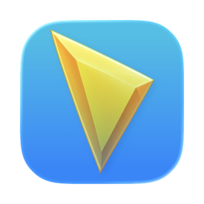

<h1 align="center">Dojo</h1>

Developer tools for macOS: formatters, converters, encoders, generators and more, in one native-feeling app.

<a href="https://github.com/IndieGoodies/Dojo/releases/latest/download/Dojo.zip"><b>Download Dojo</b></a>

## Requirements

- macOS 13 or later
- Apple Silicon Mac

## Updates

Dojo checks for updates on its own. You can also download the latest version from
[Releases](https://github.com/IndieGoodies/Dojo/releases/latest).
